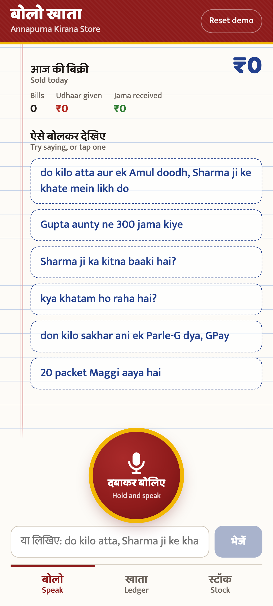
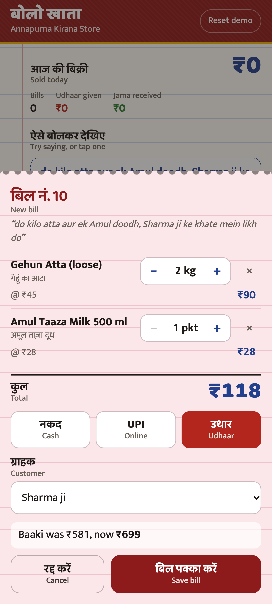
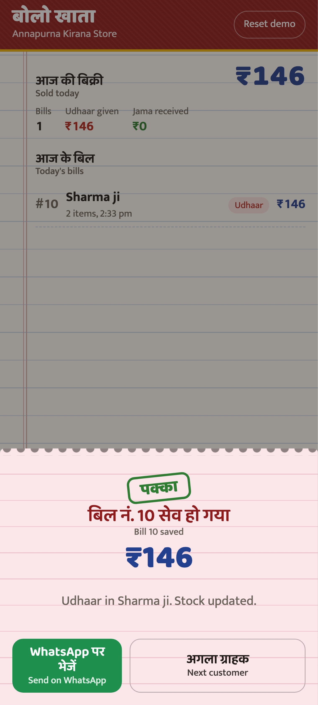
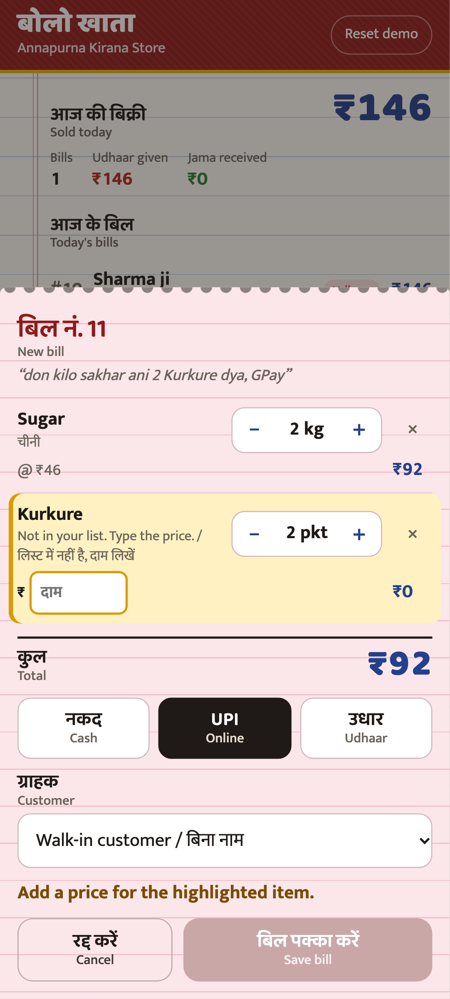
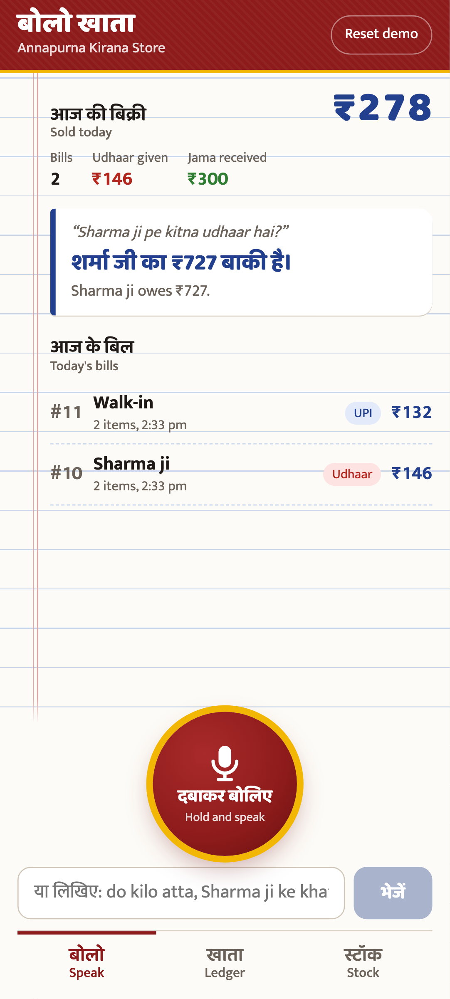
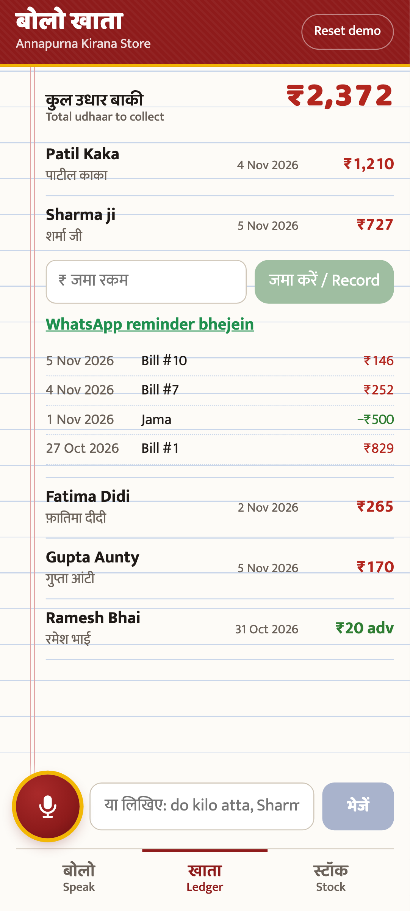
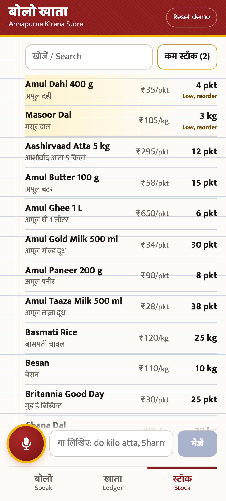
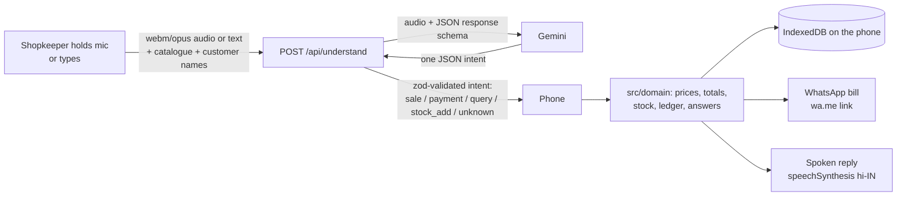

# Bolo Khata

**Bolkar bill banaiye, udhaar ka hisaab rakhiye.** A voice-first billing and udhaar (credit) ledger for Indian kirana stores, built on Gemini.

The shopkeeper holds one button and talks the way they already talk at the counter:

> "do kilo atta aur ek Amul doodh, Sharma ji ke khate mein likh do"

and gets an itemised bill priced from their own catalogue, a stock update, an entry in Sharma ji's khata, and a bill they can send on WhatsApp. No typing, no menus. Hindi, Hinglish, Marathi and English all work, mixed in one sentence if that is how people talk.

- Live app: {{APP_URL}}
- Demo video (72 s, mobile): [`submissions/demo/bolo-khata-demo.mp4`](submissions/demo/bolo-khata-demo.mp4)
- Built by Sakshi Saboo for the Scaler x Wispr Flow voice-first hackathon (Small business track) and the Google DeepMind x Google Cloud Buildathon India 2026.

## Why

India has 13M+ kirana stores. Most still keep udhaar in a paper bahi-khata, and billing happens with both hands busy and a queue waiting. Typing on a POS or a phone keyboard is slow, and English-first apps leave many owners out. Forgotten udhaar entries and disputes cost real money and relationships. Speaking is the fastest input a shopkeeper already has.

## What it does

| Say | What happens |
|---|---|
| "do kilo atta aur ek Amul doodh, Sharma ji ke khate mein likh do" | Bill with 2 kg atta and 1 Amul Taaza, as udhaar on Sharma ji's khata. Stock goes down. |
| "don kilo sakhar ani 2 Kurkure dya, GPay" (Marathi) | Bill paid by UPI. Kurkure is not in the catalogue, so it is shown in amber with a price box, never dropped. |
| "10 rupaye ka dhaniya aur paav kilo tamatar" | Rupee amounts and fractions (paav, aadha, dedh, sava) are understood. |
| "ek litre doodh" | Converted to 2 x 500 ml packets from the pack size in the catalogue. |
| "Sharma ji ne 500 diye aur do Maggi le gaye" | Udhaar bill for the Maggi and a ₹500 repayment, in one go. |
| "Gupta aunty ne 300 jama kiye" | Payment recorded against her khata. |
| "Sharma ji pe kitna udhaar hai?" / "aaj kitna becha?" / "kya khatam ho raha hai?" | Answered on screen and spoken back in Hindi. |
| "supplier se 10 packet Tata chai patti aayi" | Stock goes up. |

Every bill is editable before saving (quantities, prices for unknown items, customer, cash / UPI / udhaar). After saving: send on WhatsApp as a formatted bill (`wa.me` link, straight to the customer's number if it is on file). The Khata screen shows who owes what, full history, a one-tap payment entry and a polite WhatsApp reminder.

## Screenshots

| Home | Bill from voice | Saved | WhatsApp bill |
|---|---|---|---|
|  |  |  |  |

| Unknown item | Spoken answer | Khata | Stock |
|---|---|---|---|
|  |  |  |  |

(The WhatsApp screenshot and the demo video show a preview of the exact `wa.me` message, because WhatsApp cannot open inside a headless test browser.)

## How it works



- **Frontend**: Vite + React 19 + TypeScript, mobile-first installable PWA. The service worker caches the shell so the ledger and stock screens work offline.
- **AI endpoint**: one function, `POST /api/understand`. It takes `{audio, mimeType}` or `{text}` plus the shop's catalogue and customer names for grounding, calls Gemini with a JSON response schema and returns a typed intent. The same handler runs as a Vercel function (`api/understand.ts`), inside the Vite dev/preview server (`vite.config.ts`), and as a standalone Node server for Cloud Run (`server/node-server.ts`, `Dockerfile`).
- **Business logic is pure TypeScript on the device** (`src/domain/`): matching spoken words to products and customers (honorific stripping, Devanagari, romanised-Hindi spelling folding like cheeni/chini), unit and pack conversion, money in integer paise, bills, ledger balances, stock, query answers, WhatsApp text.

### How AI is used, and where it is not

Gemini does one job: turn messy speech into structured intent. It listens to the audio directly (no separate speech-to-text step) and returns items, quantities, units, customer, payment mode and query type.

**Gemini never decides money.** Prices come from the shop's catalogue and totals are computed in code, so a mis-hearing can never invent a price. An item the model cannot match is shown in amber for the owner to price. Everything is shown on an editable bill before it touches the ledger.

Guardrails on the endpoint: the API key lives only on the server; 1 MB body cap (checked while streaming); 30 s recording cap on the client; 8 s model timeout; per-IP rate limit (40/min, in memory); strict zod validation of both the request and the model output; incomplete intents are downgraded to "unknown" rather than guessed; upstream error text is never returned to the browser.

### Model choice and accuracy

`GEMINI_MODEL` picks the model; the default is **`gemini-3.5-flash`** (stable). `gemini-2.5-flash` is deprecated and gets re-routed from 1 Dec 2026, so it is no longer the default. `GEMINI_THINKING` (`minimal`/`low`/`medium`/`high`/`default`) tunes thinking; the default turns it off for 2.5 and uses `low` on 3.x, because parsing a shop command does not need deep reasoning and every second at the counter counts.

`scripts/eval.ts` sends real utterances through the local server to the live Gemini API and scores them. Two sets:

- **Main set**: 25 commands across Hindi (Devanagari), Hinglish, Marathi, English and mixes, covering sales (udhaar, UPI, cash, rupee amounts, unknown items, a new customer), payments, all three question types, stock deliveries, small talk and a purchase-plus-repayment mix.
- **Held-out set**: 13 more, written after the prompt was tuned and not used to tune it.

"Intent" means the right action was picked. "All fields" also requires the right catalogue items, customer, payment mode, amounts and money handed over.

| Model | Main: intent | Main: all fields | Held-out: intent | Held-out: all fields | Median latency (text) |
|---|---|---|---|---|---|
| **gemini-3.5-flash** (default) | 25/25 | 25/25 | 13/13 | 13/13 | about 2.2 s |
| gemini-3-flash-preview | 25/25 | 25/25 | 13/13 | 13/13 | about 1.5 s |
| gemini-3.8-flash | 25/25 | 25/25 | 13/13 | 13/13 | about 2.8 to 3.6 s |
| gemini-2.5-flash (deprecated) | 25/25 | 25/25 | 13/13 | 12/13 | about 1.4 s |

Run logs are in [`docs/eval/`](docs/eval). Be careful reading 100%: these are 38 utterances written by the builder, not field recordings from shops. A larger real-world set is the first item on the roadmap.

**Audio**: tested end to end by synthesising Hindi speech with macOS `say -v Lekha`, encoding it to webm/opus with ffmpeg (about 18 KB) and sending it through the same audio path the mic uses (`scripts/audio-test.sh`). A sale, a payment and a question all came back correct, in about 2.5 to 5 s depending on the model. The browser mic has not been tested with a real human voice in this build.

## Privacy

All shop data (catalogue, customers, bills, khata) lives in IndexedDB on the shopkeeper's phone. There is no account, no server database and no sync. The only thing that leaves the device is the command being understood: the audio clip or typed text, plus the product list and customer names needed to understand it. Nothing is stored server-side. "Reset demo" wipes the device copy back to the sample shop.

## Run it locally

Needs Node 20+ and a Gemini API key in the environment.

```bash
npm install
export GEMINI_API_KEY=...            # never committed; read only by the server side
export GEMINI_MODEL=gemini-3.5-flash # optional, this is the default
npm run dev                          # http://localhost:5173 with /api/understand mounted
```

No Vercel login or link is needed: `vite.config.ts` mounts the same handler the Vercel function uses. The mic needs `localhost` or HTTPS. Without a mic, type commands or tap the examples on the home screen.

Other ways to run it:

```bash
npm run build && npm run preview          # production build on :4173, same API
npm run build && npm run build:server && PORT=8080 npm start   # the Cloud Run server
docker build -t bolo-khata . && docker run -p 8080:8080 -e GEMINI_API_KEY bolo-khata
```

## Tests

```bash
npm run typecheck
npm test                 # 103 vitest tests: all domain logic + API contract tests with Gemini mocked
npm run test:e2e         # Playwright smoke on a Pixel 7 viewport, against the local server and real Gemini
npm run eval             # 25-utterance live eval (needs the dev server running)
npm run eval:holdout     # 13 held-out utterances
scripts/audio-test.sh    # real Hindi audio through the audio path (macOS)
npm run demo:record      # re-records the demo video and screenshots
```

## Deploying

Nothing has been deployed yet. [`scripts/publish.sh`](scripts/publish.sh) holds the exact steps and runs only when asked:

- `scripts/publish.sh github`: creates the public repo `sakshi12saboo/bolo-khata` and pushes, using `sakshi12saboo`'s own gh token without touching the active gh account.
- `scripts/publish.sh vercel`: links Vercel project `bolo-khata`, sets `GEMINI_API_KEY` and `GEMINI_MODEL` from the shell without printing them, deploys to production, smoke-tests the live API and writes the URL into this README.
- `scripts/publish.sh cloudrun`: optional deploy of the same container to Google Cloud Run in `asia-south1`, with the key in Secret Manager.

## Decisions

Sakshi delegated every call; these are the ones that matter.

- **Fresh scaffold, no starter.** GitHub search (kirana voice, khata udhaar, voice billing Gemini, bahi khata) turned up only 0 to 2 star hackathon repos with no licence. Not worth adopting.
- **Deps kept small and pinned**: react, react-dom, zod, @google/genai, idb-keyval at runtime; vite, vitest, Playwright and TypeScript for dev. Every version was at least two weeks old at install time. The genai preinstall script is an `echo`; nothing else has install scripts. `npm audit`: 0 vulnerabilities.
- **Default model `gemini-3.5-flash`.** It matched the best accuracy, is stable and avoids the 2.5 deprecation. 3-flash-preview is a little faster but is a preview.
- **Flat response schema, union in code.** Gemini fills one flat JSON object; the server maps it to a strict discriminated union and validates it with zod. This was more reliable than asking for a union.
- **Grounding with the shop's own catalogue and customers** in every request, so the model returns SKUs and existing customer names, and a fuzzy matcher on the phone backs it up.
- **A purchase plus money handed over** ("500 diye aur do Maggi le gaye") becomes a sale carrying `paidRupees`. For a named customer that is an udhaar bill plus a repayment; for a walk-in it shows the change to return.
- **A named customer with no payment mode means udhaar.** That is how a kirana khata works.
- **Hold to talk, or tap to latch.** A quick tap starts recording and a second tap sends, for one-handed use; Space/Enter work from a keyboard.
- **Stock never goes below zero.** Selling more than recorded stock clamps to 0 instead of erroring at the counter.
- **Spoken replies only for questions.** Talking over every bill would get annoying in a busy shop.

## Known gaps

- Eval utterances are builder-written text plus synthetic TTS audio. No recordings from real shops yet, and the browser mic has not been tried with a real voice in this build.
- The rate limit is per serverless instance and resets on cold start. Enough for a demo, not for abuse at scale.
- New products cannot be added from the app yet (unknown items can be billed with a typed price, and are skipped on stock deliveries).
- No undo for a saved bill; a wrong bill needs a correcting entry.
- One device, one shop: no sync or backup beyond the browser's own storage.
- Spoken answers depend on the device having a Hindi voice for `speechSynthesis`. Without one the answer is still shown on screen.

## Roadmap

1. Collect 200+ real counter recordings (with consent) across cities and grow the eval set from them.
2. Add-product and edit-price by voice ("Kurkure 20 rupaye ka hai, list mein daal do").
3. Undo and edit for saved bills, and a daily closing summary on WhatsApp.
4. Optional encrypted backup to the owner's Google Drive.
5. UPI collect links and udhaar reminders on a schedule.
6. GST invoices and supplier re-orders from low stock.

## Project layout

```
api/understand.ts        Vercel function entry
server/                  handler (validation, caps, timeout), Gemini client, prompt + schema, rate limit,
                         Node adapter, Cloud Run server
src/shared/intent.ts     zod schemas shared by browser and server
src/domain/              pure business logic + seed shop (40 SKUs, 5 customers)
src/state/, src/lib/     IndexedDB persistence, recorder, speech, API client
src/ui/                  React screens and sheets
tests/                   vitest (domain + API contract)
e2e/                     Playwright smoke + recorded demo
scripts/                 eval, audio test, publish
docs/                    spec, plan, eval logs, screenshots
```
